# Caso de Estudio — Sistema de Gestión de Residuos Vecinales (Geo Maps)

**Cátedra:** Arquitecturas Móviles · Ing. Juan Pablo Bono  
**Carrera:** Ingeniería en Sistemas de Información — UTN FRSFCO  
**Alumno:** Fernando Mare  
**Fecha:** 09/11/2026  
**Repositorio:** https://github.com/mareFernando03/vecino-sf (el mismo código cubre el Práctico 5:
la app ciudadana suma los servicios municipales de ese práctico)

---

## 1. Objetivo y alcance

El caso pide diseñar y prototipar un sistema de aplicaciones móviles y servicios en la nube para
gestionar la recolección de residuos de San Francisco, con una aplicación para cada actor
(ciudadanos, autoridades y personal de recolección), mapas y rutas optimizadas, notificaciones
push y una arquitectura que escale con contenedores, orquestación, autoescalado y monitoreo.

Se construyó el sistema completo y funcionando, no sólo su diseño:

- **Tres aplicaciones** sobre un mismo backend: la del vecino (celular), el panel de la
  autoridad (escritorio) y la del recolector (celular, con lector de QR).
- **Backend** en FastAPI con PostgreSQL, eventos en tiempo real y push web.
- **Docker y Kubernetes:** imágenes, `docker-compose` con réplicas detrás de un balanceador y
  manifiestos de Kubernetes con autoescalado. Se probaron en un clúster k3s.
- **Monitoreo** con Prometheus y Grafana, y pruebas de carga que muestran el escalado.

> **Datos simulados.** Las ubicaciones caen dentro de la ciudad, pero contenedores, puntos de
> reciclaje, horarios y rutas son datos de ejemplo: el municipio no publica esa información en
> una API. Los sensores de llenado se simulan con un proceso aparte (sección 5.1).

## 2. Arquitectura

<figure class="ancha grande">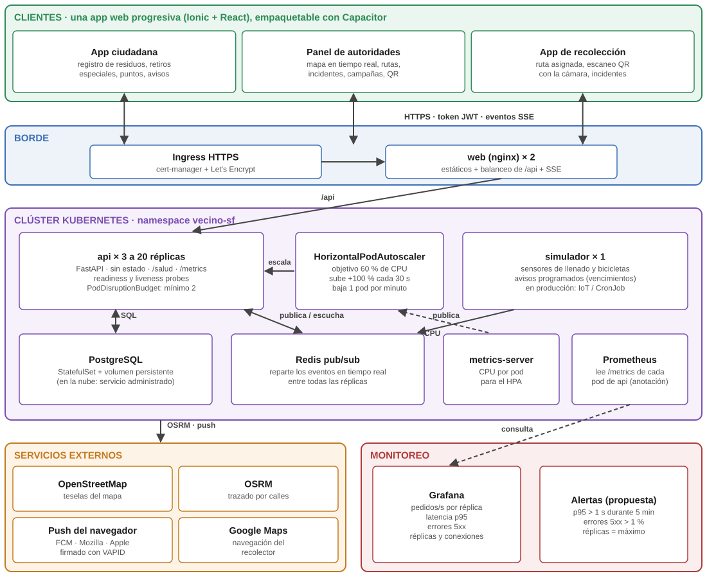<figcaption>Figura 1. Arquitectura de la solución. Probado: docker compose y k3s de un nodo. Sólo diseñado: el Ingress con HTTPS, las alertas y el despliegue en la nube.</figcaption></figure>

### 2.1 Decisiones y su justificación

| Decisión | Por qué |
|---|---|
| **Una app web progresiva (PWA) con tres roles**, en Ionic + React | Las tres apps comparten mapa, sesión y avisos. Un solo código evita mantener tres. El rol del usuario define qué pantallas ve y qué puede hacer. La autoridad la usa en una PC; el vecino y el recolector la instalan en el celular. **Capacitor** quedó configurado para empaquetarla como app de Android o iOS (no se empaquetó). |
| **Backend sin estado** (FastAPI) | La sesión viaja en el token JWT y los datos están en PostgreSQL, así que cualquier réplica atiende cualquier pedido y se pueden sumar o sacar réplicas en caliente. Dos excepciones: las conexiones de tiempo real abiertas (si una réplica se apaga, el navegador se reconecta solo a otra) y los adjuntos de reclamos, que en Kubernetes necesitan un almacenamiento compartido (sección 8). |
| **Contenedores (Docker) y orquestación (Kubernetes)** | Frente a un **PaaS** (por ejemplo, Cloud Run o App Service), Kubernetes da control del autoescalado, de las sondas de salud y de cuántas conexiones abre cada réplica, y los mismos manifiestos corren en cualquier nube o en un servidor del municipio, sin atarse a un proveedor. A cambio, hay que operar el clúster: para un municipio chico un PaaS con contenedores sería más simple, y la misma imagen Docker serviría. Un **MBaaS** (Firebase) resuelve sesión, base y push sin servidor propio, pero el ruteo, la selección de paradas y los permisos por rol quedarían repartidos en funciones sueltas y atados a una base no relacional. **Serverless** puro no sirve para el tiempo real, porque las conexiones SSE quedan abiertas minutos. |
| **PostgreSQL** | Los datos son relacionales (rutas, paradas, contenedores, incidentes) y necesitan transacciones. Por ejemplo, registrar una recolección actualiza la ruta, el contenedor y la solicitud en una sola operación. En la nube se usa un servicio administrado. |
| **Tiempo real con Server-Sent Events + Redis** | El panel y la app del recolector necesitan ver los cambios al instante. Alcanza con un canal del servidor al cliente: SSE es HTTP común, atraviesa proxies y el navegador se reconecta solo. Con varias réplicas, un cambio en una tiene que llegarle a clientes conectados a otra: cada réplica publica en Redis y todas escuchan. |
| **Mapas con Leaflet + OpenStreetMap** | Sin clave ni costo por carga de mapa. Para producción con mucho tráfico conviene un proveedor con SLA (Mapbox o Google Maps). El cambio es una línea en `Mapa.tsx`. |
| **Ruteo con OSRM** | Motor de ruteo libre sobre OpenStreetMap. Traza el recorrido por calles. Si no responde, la ruta igual se arma con tramos rectos. |
| **Push web con VAPID** | El servidor firma cada aviso y lo envía al servicio de push del navegador (Google, Mozilla o Apple). No depende de Firebase. En la app empaquetada se usaría FCM nativo. |
| **Simulador en un proceso aparte** | Los sensores de llenado y las tareas programadas tienen que correr una sola vez, no una por réplica. Por eso es un Deployment de una réplica. |

## 3. Prototipo funcional

Todas las capturas salen de un recorrido automático que también funciona como prueba de
punta a punta (`frontend/pruebas/capturas.mjs`). Ingresa con cada rol y completa cada flujo;
en cada paso espera el texto que tiene que aparecer y, si no aparece, la corrida se corta.

### 3.1 Aplicación ciudadana

El vecino registra los residuos que genera, por categoría y cantidad, y ve su resumen de los
últimos 30 días. Pide el retiro de un residuo especial (voluminoso, reciclable o peligroso)
marcando el lugar en el mapa o con su ubicación. Consulta los puntos de reciclaje con sus
materiales y horarios, con un enlace para llegar con Google Maps, y los horarios de recolección
de su zona. Los avisos de campañas y del retiro llegan como notificación.

<figure>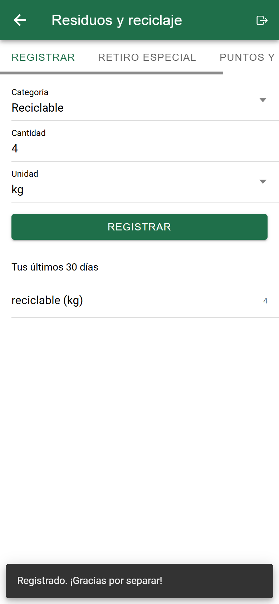<figcaption>Figura 2. Registro de residuos y resumen</figcaption></figure>
<figure>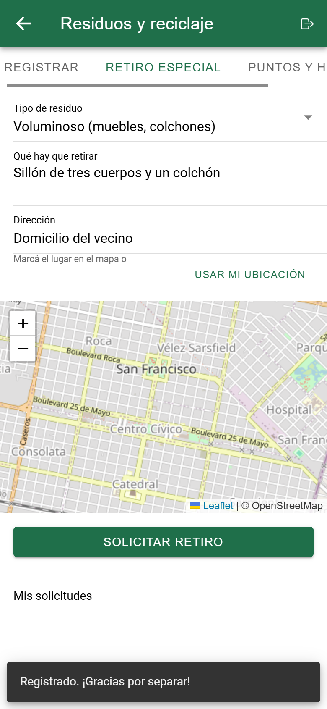<figcaption>Figura 3. Solicitud de retiro especial</figcaption></figure>
<figure>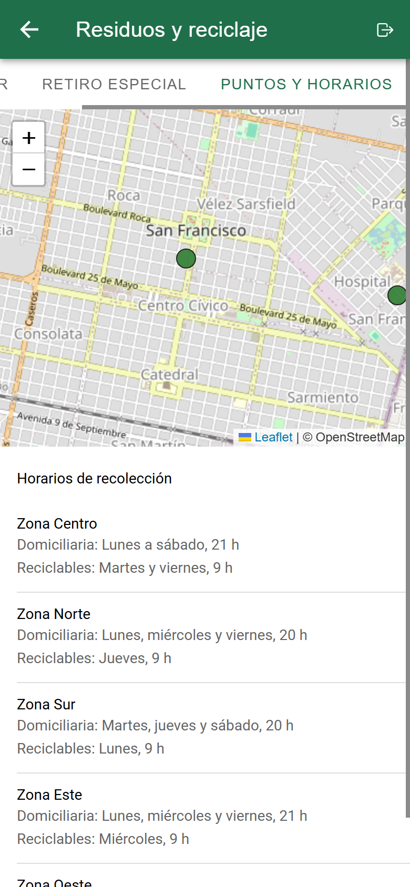<figcaption>Figura 4. Puntos de reciclaje y horarios</figcaption></figure>

### 3.2 Panel de autoridades

El panel muestra en un mapa los 30 contenedores con su llenado en tiempo real (verde, amarillo,
rojo; negro si está dañado o bloqueado), las solicitudes especiales pendientes y las rutas en
curso. Arriba hay indicadores del día.

Para **planificar una ruta**, la autoridad elige el recolector, las zonas y el umbral de
llenado. El sistema toma los contenedores que lo superan y las solicitudes pendientes, las
ordena con el optimizador y asigna la ruta. El recolector recibe un push si activó los avisos
desde su app (botón «Activar avisos de rutas nuevas»); con la app abierta, la ruta aparece sola
por el canal de tiempo real.

Desde el mismo panel se resuelven incidentes, se envían campañas o eventos de limpieza a los
vecinos y se imprimen los QR de los contenedores.

<figure class="ancha">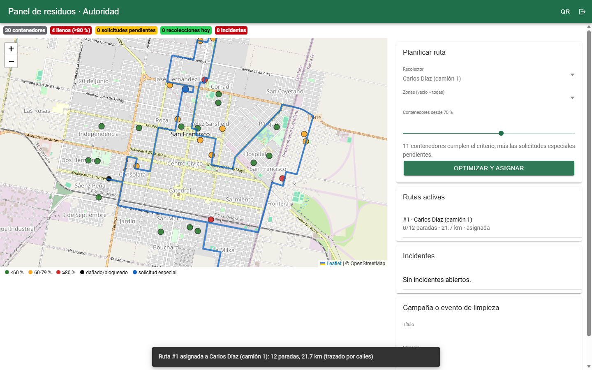<figcaption>Figura 5. Ruta asignada: 13 paradas, 22,73 km, trazada por calles</figcaption></figure>

<figure class="ancha">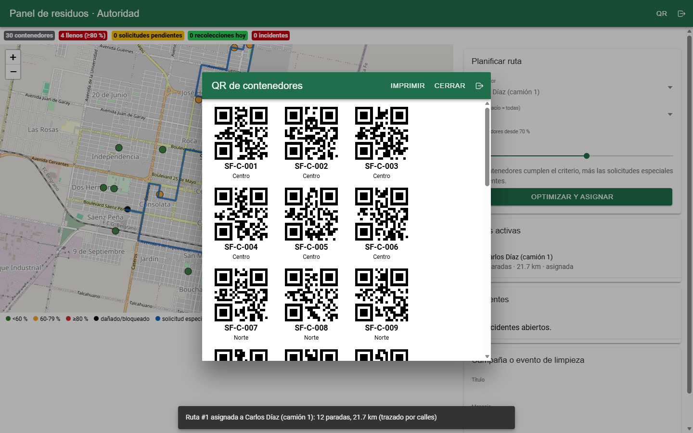<figcaption>Figura 6. QR de los contenedores, listos para imprimir y pegar</figcaption></figure>

### 3.3 Aplicación de recolección

El recolector ve su ruta en el mapa y la lista de paradas en orden. La próxima parada está
resaltada, con un enlace para navegar hasta ella. En cada contenedor escanea el QR con la
cámara; si la cámara falla, tipea el código. Eso registra la recolección:

- el contenedor vuelve a 0 %;
- el panel se actualiza al instante;
- si la parada era una solicitud, el vecino recibe el aviso «Retiramos tu residuo especial».

También reporta incidentes. Un contenedor dañado o bloqueado queda fuera de las próximas rutas
hasta que la autoridad lo resuelve.

<figure>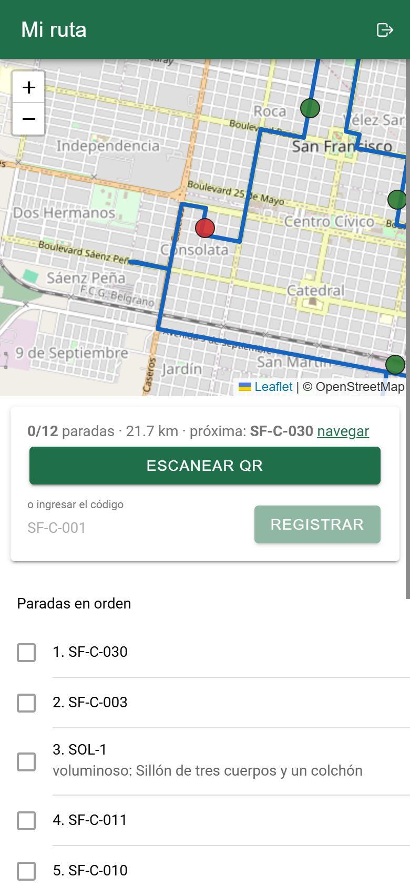<figcaption>Figura 7. Ruta en orden</figcaption></figure>
<figure>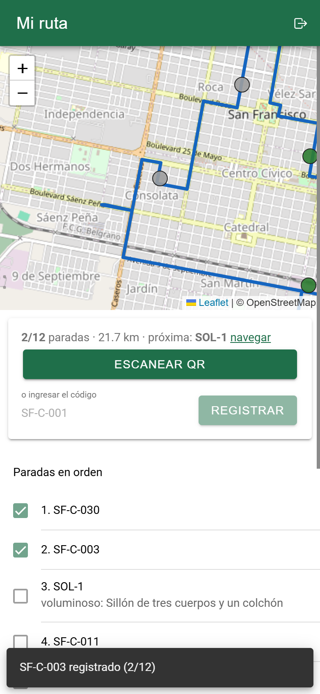<figcaption>Figura 8. Dos paradas registradas</figcaption></figure>
<figure>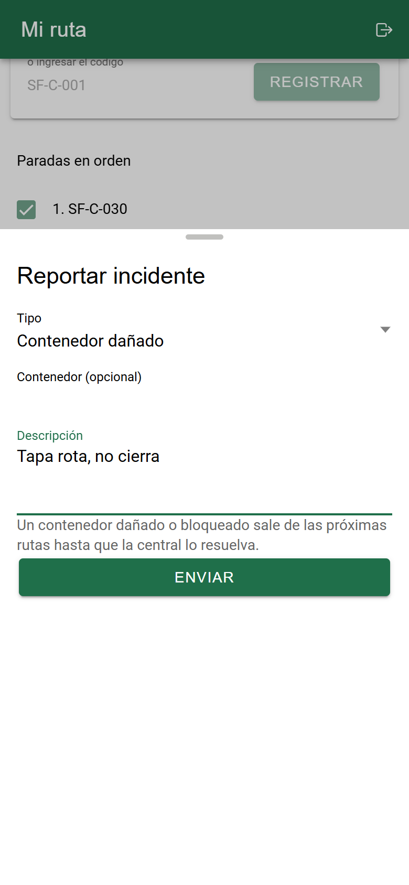<figcaption>Figura 9. Reporte de incidente</figcaption></figure>

## 4. Flujo de trabajo y rutas optimizadas

<figure class="ancha">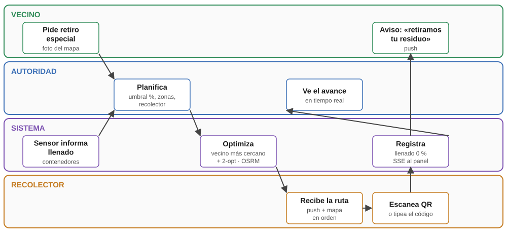<figcaption>Figura 10. Flujo de la recolección entre los cuatro actores</figcaption></figure>

**Selección de paradas.** Entran los contenedores en buen estado cuyo llenado supera el umbral,
y las solicitudes especiales pendientes. Lo que ya está asignado a otra ruta activa no se repite,
así dos camiones no van al mismo punto. Si dos personas planifican a la vez, un candado de
PostgreSQL hace que la segunda planificación espere a la primera y vea sus paradas ocupadas.

**Lo que no es.** La ruta se optimiza una vez, al planificarla: no se recalcula durante el
recorrido.

**Orden.** `backend/app/rutas.py` resuelve un problema del viajante: salir de la base, pasar por
todas las paradas y volver.

1. Arma una primera ruta yendo siempre a la parada más cercana (*vecino más cercano*).
2. La mejora con **2-opt**: invierte tramos mientras el recorrido total se acorte.

Para 20 a 40 paradas tarda milisegundos. No garantiza el óptimo: es una heurística. Una prueba automática
verifica, sobre 20 casos al azar, que 2-opt nunca empeora la ruta inicial y que se visitan
todas las paradas.

**Trazado.** El orden se calcula con distancias en línea recta (Haversine). El recorrido real
por calles lo devuelve OSRM. En la Figura 5, la ruta de 13 paradas mide 22,73 km por calles.

**Mejoras posibles.** El paso siguiente es optimizar con restricciones de capacidad del camión
y ventanas horarias. Eso es un problema de ruteo de vehículos (VRP), que se resuelve con
OR-Tools o con el optimizador de Google Maps. La interfaz `optimizar(puntos)` no cambia.

## 5. Escalado y monitoreo

### 5.1 Contenedores (Docker)

| Imagen | Contenido |
|---|---|
| `vecino-sf/api` | Python 3.12 + FastAPI. Un proceso por contenedor y usuario sin privilegios. La misma imagen corre el simulador con otro comando. |
| `vecino-sf/web` | Compilación en dos etapas: Node compila la app y nginx sirve los archivos estáticos y balancea `/api` entre réplicas. |

`deploy/docker-compose.yml` levanta el sistema entero en una máquina:

- PostgreSQL y Redis;
- 3 réplicas de la API;
- el simulador;
- nginx;
- Prometheus y Grafana.

Con `docker compose up -d --scale api=6` se escala en caliente: nginx y Prometheus descubren
las réplicas nuevas por DNS.

### 5.2 Orquestación (Kubernetes)

| Manifiesto | Qué define |
|---|---|
| `00-base.yaml` | Namespace, configuración y secretos (JWT, base, claves VAPID). |
| `10-datos.yaml` | PostgreSQL con volumen persistente y Redis. |
| `20-api.yaml` | API: Deployment de 3 réplicas con *probes* de salud (sólo preguntan si el proceso responde, sin tocar la base), actualización sin cortes (`maxUnavailable: 0`), **HorizontalPodAutoscaler** de 3 a 20 réplicas al 60 % de CPU y *PodDisruptionBudget* de mínimo 2. Además, el simulador con una réplica. |
| `30-web.yaml` | nginx con 2 réplicas, Service e Ingress con HTTPS (cert-manager). |
| `40-monitoreo.yaml` | Prometheus que encuentra solo cada pod de la API por anotación. |

El HPA sube rápido, duplicando réplicas cada 30 s, y baja despacio, de a una por minuto
después de 5 minutos estables. Así responde a un pico sin oscilar cuando la carga baja.

### 5.3 Monitoreo

Cada réplica expone `/metrics`: pedidos por ruta, latencia y errores, más una métrica propia
con las conexiones de tiempo real abiertas. Como cada contenedor corre un solo proceso, cada
réplica reporta un solo juego de métricas. El histograma de latencia llega hasta 10 s (los
cortes por defecto terminaban en 1 s y no dejaban ver un p95 mayor).

- **En docker compose**, Prometheus encuentra las réplicas por DNS y Grafana muestra un tablero
  que se carga solo al levantar el sistema (Figuras 11 y 12).
- **En Kubernetes**, Prometheus encuentra cada pod por su anotación. Grafana no se desplegó en
  el clúster: se usaría el mismo tablero.

Como alertas se proponen tres (no están configuradas):

- latencia p95 mayor a 1 s durante 5 minutos;
- más de 1 % de errores 5xx;
- el HPA llegó al máximo de réplicas, porque eso indica que hay que subir el techo o mejorar la
  base.

Falta medir la base: conexiones en uso y espera por una conexión libre. Las pruebas de la
sección 5.4 muestran que ahí estuvieron los problemas, y en esta prueba se midieron a mano
(`pg_stat_activity`).

<figure class="ancha">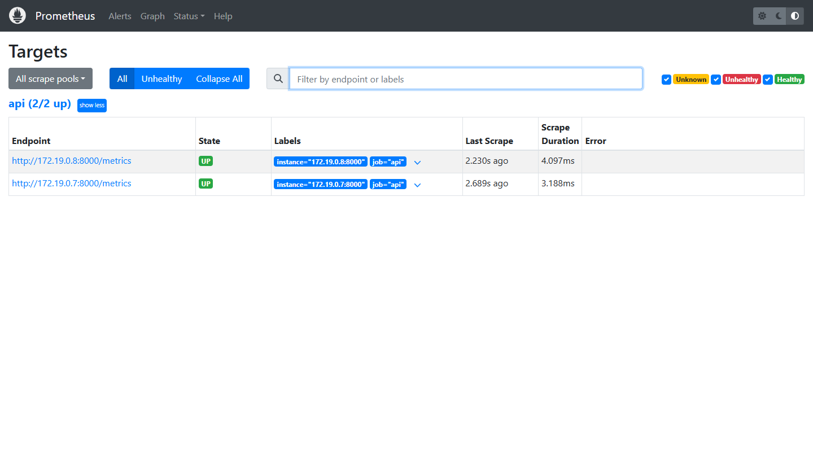<figcaption>Figura 11. Prometheus encuentra solo las réplicas de la API (docker compose)</figcaption></figure>

<figure class="ancha">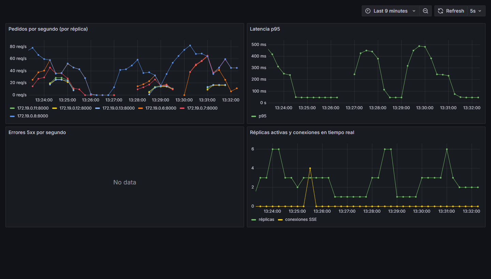<figcaption>Figura 12. Grafana durante dos tandas de la prueba de carga de la sección 5.4: pedidos por réplica, latencia p95 medida en el servidor, errores 5xx (ninguno) y réplicas activas (1, 3 y 6). El pico amarillo son las 4 conexiones de la prueba de tiempo real.</figcaption></figure>

### 5.4 Pruebas de escalado

Las pruebas usan `deploy/prueba_carga.py`: cada usuario virtual recorre sin pausas el mapa, la
cuenta, los reclamos, los avisos, los puntos y las alarmas. Los generadores corren **dentro**
de la red de Docker o del clúster, no desde Windows. Todo corre en una sola computadora de 8
procesadores, compartidos por las réplicas, la base, nginx y los generadores.

**docker compose** (`deploy/bateria_carga.sh`, registro en `docs/prueba-carga.log`).
120 usuarios simultáneos durante 25 s; la mediana y el p95 son los del peor de los tres
generadores:

| docker compose, 120 usuarios | Pedidos/s | Mediana | p95 | Errores |
|---|---|---|---|---|
| 1 réplica | 131 | 1.064 ms | 1.626 ms | 0 |
| 3 réplicas | 380 | 304 ms | 586 ms | 0 |
| 6 réplicas | 418 | 214 ms | 784 ms | 0 |

- De 1 a 3 réplicas se atiende casi el triple y la mediana baja de 1 s a 0,3 s.
- De 3 a 6 la mejora es chica (10 %): la computadora ya no tiene procesadores libres. En un
  clúster de varios nodos cada réplica nueva traería su propia CPU.
- Con 60 usuarios, 1 réplica alcanza (113 pedidos/s, sin errores) y 3 ó 6 rinden igual
  (202 pedidos/s): con poca carga, más réplicas no suman.

**Redundancia.** Con 3 réplicas y 60 usuarios se tiró una réplica a los 8 segundos
(`docker kill`): **0 errores**, porque nginx reintenta en otra réplica. En Kubernetes, además,
el Deployment recrea el pod caído.

**Autoescalado en Kubernetes** (`deploy/k8s/prueba/corrida.sh`). Se aplicaron los manifiestos en
k3s y se lanzaron 3 generadores de 40 usuarios durante 3 minutos. Primero con 3 réplicas fijas
como línea base, después con el HPA activo. Cada 15 s se registró el HPA y las conexiones
abiertas en PostgreSQL:

| Kubernetes, 120 usuarios, 3 min | 3 réplicas fijas | HPA de 3 a 20 |
|---|---|---|
| Réplicas | 3 | 3 → 6 → 12 → **20** en unos 70 s |
| Pedidos/s | 368 | 401 |
| Mediana / p95 | 229 / 901 ms | 193 / 885 ms |
| Errores | 0 | 0 |
| Conexiones a la base (máximo) | 26 | 82 (tope: 20 × 6 = 120 < 150) |

El HPA reaccionó como está configurado: duplicó réplicas cada 30 s hasta el máximo. La mejora
sobre la línea base es chica por lo mismo que en compose: es un solo nodo, y 20 pods se reparten
los mismos 8 procesadores. Con 20 réplicas la CPU siguió en 80 %, por encima del objetivo de 60 %, así que en un
clúster real el HPA habría pedido más nodos. Registros: `docs/prueba-k8s-base-3-replicas.log` y
`docs/prueba-hpa.log`.

**Lo que encontraron las pruebas.** Cada problema se corrigió en el código y la medición se
repitió. Los registros de las corridas fallidas quedaron en `docs/`:

| Problema | Cómo se vio | Corrección |
|---|---|---|
| **Demasiadas conexiones a la base.** La primera imagen corría 2 procesos por contenedor con 15 conexiones cada uno: 20 réplicas pedían hasta 600, y PostgreSQL acepta 100. | 45 errores *too many clients already* al llegar a 20 réplicas (`prueba-hpa-imagen-anterior.log`). | Un proceso por contenedor y un tope de 4 + 2 conexiones por réplica: 20 réplicas usan hasta 120, y PostgreSQL acepta 150. |
| **La sonda de vida mataba réplicas sanas.** `/salud` consultaba la base; bajo carga esperaba una conexión libre, vencía al segundo y Kubernetes reiniciaba el pod. | 8 reinicios en 3 minutos y unos 1.300 errores (`prueba-k8s-sonda-con-base.log`). | `/salud` sólo dice si el proceso responde, sin tocar la base, y las sondas toleran 3 s y 5 fallas. |
| **Conexiones retenidas sin uso.** Cada pedido tomaba una conexión al validar el usuario y la retenía mientras esperaba un hilo libre. Con pocas conexiones por réplica, los pedidos se trababan entre sí. | 6 pedidos/s por generador, CPU al 20 % y conexiones *idle in transaction* de más de 30 s en `pg_stat_activity` (`prueba-k8s-sesiones-trabadas.log`). Un primer intento de corrección no alcanzó (`prueba-k8s-sesion-async.log`). | La conexión se devuelve apenas se valida el usuario, y la sesión se abre y se cierra fuera del grupo de hilos. Es la causa de que, en la primera medición, 1 réplica colapsara con 120 usuarios: no faltaba capacidad. |
| **Una réplica dejaba de repartir el tiempo real.** La tarea que escucha Redis se creaba sin guardar una referencia, y el recolector de basura de Python la destruyó bajo carga. | Después de la carga, sólo 1 de 3 réplicas reenviaba los eventos («Task was destroyed but it is pending» en el log). | Se guarda la tarea y se reconecta sola si Redis se corta. `docs/prueba-tiempo-real.log` se corre justo después de la carga. |

**Qué se haría en producción:**

- Un *pooler* de conexiones (PgBouncer) delante de PostgreSQL, para poder sumar réplicas sin
  acercarse al límite de la base.
- Escalar también por una métrica de la base o de la latencia, no sólo por CPU: los tres
  primeros problemas de la tabla no se veían en la CPU.
- Un piso de réplicas más alto en los horarios de pico conocidos, por ejemplo los días de
  vencimiento, con un CronJob que ajusta `minReplicas`.

## 6. Pruebas funcionales

- **API:** `backend/tests/test_api.py` tiene 21 pruebas automáticas de toda la app; las de
  este caso son:
    - permisos por rol (sin sesión, 401; con un rol equivocado, 403);
    - registro y solicitud del vecino;
    - planificación de una ruta sin repetir paradas, escaneo de QR válido, inexistente y
    repetido, aviso al vecino e incidente (un recorrido completo en una sola prueba);
    - el optimizador, sobre 20 casos al azar;
    - el push: un servicio de push falso recibe el aviso, verifica la firma VAPID y descifra el
    contenido con las claves del navegador.
- **Tiempo real entre réplicas:** `deploy/prueba_tiempo_real.py` (registro en
  `docs/prueba-tiempo-real.log`). Con 3 réplicas, un cliente conectado a cada una recibe los 6
  cambios aunque cada uno entre por una réplica distinta, y un aviso personal sólo le llega a su
  dueño.
- **Interfaz:** el recorrido de punta a punta de la sección 3 (25 pasos con captura).

## 7. Propuestas para la participación ciudadana

Lo construido ya da al vecino:

- su propio registro de residuos;
- el seguimiento de cada retiro especial;
- un aviso cuando el camión pasó.

Sobre esa base se proponen tres mejoras, **no implementadas**:

- **Puntos por separar:** cada registro reciclable y cada entrega en un punto verde, validada
  con el QR del punto, suma puntos canjeables en comercios adheridos.
- **Mapa de calor de generación por zona:** para ubicar contenedores y puntos verdes donde más
  hacen falta.
- **Reporte de basurales con foto:** reusa el centro de reclamos del Práctico 5. La autoridad
  los convierte en paradas de una ruta.

## 8. Limitaciones

- **Datos simulados:** contenedores, sensores, puntos, horarios y montos.
- **Push en un navegador real:** la suscripción no se probó de punta a punta. El navegador
  automatizado rechaza el permiso de notificaciones. Sí se verificó el envío: firma VAPID y
  cifrado según el estándar, comprobados por la prueba de la sección 6. Los avisos con la app
  abierta llegan por el canal de tiempo real.
- **Kubernetes:** se probó en un clúster local de un nodo (k3s dentro de Docker), no en la nube.
  En un solo nodo, más pods no suman CPU real: la prueba demuestra que el autoescalado reacciona,
  no cuánta capacidad daría un clúster de varios nodos.
- **Base de datos y Redis:** un solo pod cada uno, sin réplicas ni copias de seguridad. En la
  nube corresponden servicios administrados con réplica y backup. No hay migraciones: las tablas
  se crean al arrancar.
- **Adjuntos de reclamos:** quedan en el disco del pod. En producción van a un almacenamiento
  de objetos (S3 o Cloud Storage).
- **Mapas y ruteo:** se usan las teselas públicas de OpenStreetMap y el servidor de
  demostración de OSRM, que no admiten tráfico de producción. Corresponde un proveedor con SLA o
  servidores propios.
- **Campañas:** un aviso a toda la ciudad se envía dentro del mismo pedido de la autoridad. Con
  miles de vecinos habría que encolarlo y mandarlo desde un proceso aparte.
- **Seguridad:** la clave que firma los tokens es un valor de ejemplo que hay que generar al
  desplegar, y el ingreso no limita los intentos.
- **Monitoreo:** Grafana se probó en docker compose; en Kubernetes se despliega sólo Prometheus.
  Las alertas están propuestas, no configuradas. No se miden la base ni su grupo de conexiones,
  que fue el cuello de botella real (sección 5.4).
- **App nativa:** la configuración de Capacitor está lista, pero no se generó el APK.

## 9. Cómo correrlo

Instrucciones completas en el `README.md` del repositorio. Resumen:

- **Desarrollo:** `uvicorn app.main:app` (backend) y `npm run dev` (frontend).
- **Sistema completo:** `docker compose up -d --build` en `deploy/`. La app queda en el puerto
  8080 y Grafana en el 3000.
- **Kubernetes:** `kubectl apply -f deploy/k8s/`.
- **Usuarios de prueba:** botones en la pantalla de ingreso.
