# Trabajo Práctico 5 — Estrategias de Arquitecturas Móviles No Nativas

**Cátedra:** Arquitecturas Móviles · Ing. Juan Pablo Bono  
**Carrera:** Ingeniería en Sistemas de Información — UTN FRSFCO  
**Alumno:** Fernando Mare  
**Fecha:** 09/11/2026  
**Repositorio:** https://github.com/mareFernando03/vecino-sf

---

## 1. Descripción del proyecto

**Vecino SF** es una aplicación web móvil que reúne en el celular los servicios de la
Municipalidad de San Francisco:

- bicicletas públicas;
- Dirección General Tributaria;
- centro de reclamos;
- líneas de atención al vecino;
- alarmas comunitarias;
- estacionamiento medido;
- notificaciones al vecino.

Suma un octavo módulo, **residuos y reciclaje**, que conecta con el caso de estudio de gestión
de residuos de la misma cátedra (se entrega aparte).

Es una app **no nativa**: se escribe una vez con tecnologías web y funciona en cualquier
navegador móvil. Se puede instalar como app desde el navegador (PWA). Capacitor quedó
configurado para empaquetarla para Android e iOS, pero **no se empaquetó ni se probó** en esta
entrega; en ese caso el push pasaría por FCM nativo en vez del push web.

> **Datos simulados.** Las APIs del municipio no son públicas. Como permite la consigna, cada
> servicio se simuló detrás de una API propia con la forma que tendría la integración real.
> Estaciones, montos, alarmas, zonas y contactos son datos de ejemplo.

## 2. Arquitectura propuesta

<figure class="ancha">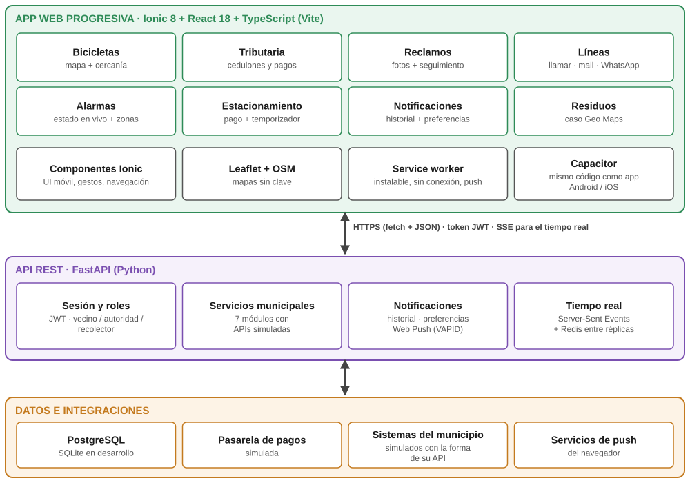<figcaption>Figura 1. Capas de la aplicación (el módulo Residuos es del caso Geo Maps)</figcaption></figure>

### 2.1 Herramientas elegidas y por qué

| Herramienta | Uso | Por qué |
|---|---|---|
| **Ionic 8 + React 18 + TypeScript** | Interfaz | Ionic es una de las herramientas que nombra la consigna. Da componentes con aspecto y gestos de app móvil (listas, hojas deslizables, segmentos, avisos), con poco estilo propio. React y TypeScript detectan errores al compilar. |
| **Vite** | Compilación | Recarga instantánea en desarrollo y una compilación de producción dividida por pantalla (sección 5.2). |
| **Service worker + manifest (PWA)** | Instalación, push | La app se instala desde el navegador y recibe notificaciones con la app cerrada. Sin señal abre la interfaz, pero los datos no se guardan para uso sin conexión. |
| **Capacitor** | Empaquetado nativo (configurado, no empaquetado) | La misma carpeta `dist/` se publicaría como app de Android e iOS si el municipio quiere estar en las tiendas. |
| **Leaflet + OpenStreetMap** | Mapas de bicis, alarmas, estacionamiento, reclamos y residuos | Sin clave de API ni costo por carga. |
| **FastAPI (Python)** | API REST | Valida cada dato de entrada con tipos y genera la documentación de la API sola (`/docs`). |
| **PostgreSQL / SQLite** | Datos | SQLite en desarrollo, PostgreSQL en producción; sólo cambia una variable. |
| **Server-Sent Events + Redis** | Tiempo real | La disponibilidad de bicis y el estado de las alarmas llegan sin recargar, aun con varias réplicas del servidor. |

### 2.2 Native vs. no nativa: por qué no nativa acá

Una app municipal tiene que llegar a **todos** los vecinos. Eso incluye celulares viejos y a
quien no quiere instalar nada: un enlace en la web del municipio o en un QR en la parada de bicis
alcanza. Las funciones que se usan son las que el navegador ya ofrece:

- GPS, para las estaciones cercanas y la ubicación de un reclamo;
- cámara, para las fotos del reclamo;
- notificaciones;
- llamadas, mail y WhatsApp, mediante enlaces.

Lo nativo sería necesario con un uso intensivo de hardware o de procesamiento, y no es el caso.
Si en algún momento hiciera falta, Capacitor permite sumar *plugins* nativos sin rehacer la app.

**Frente a las multiplataforma compiladas (React Native, Flutter):** también se escriben una
vez, pero se distribuyen por las tiendas, así que el vecino igual tiene que instalar algo y cada
cambio pasa por la revisión de Google y Apple. La PWA se actualiza al publicarla y se abre
desde un enlace.

**Lo que se pierde frente a nativo:**

- En iOS el push web sólo funciona si el vecino agrega la app a la pantalla de inicio.
- No hay ubicación en segundo plano: por eso el aviso de alarma cercana por distancia requiere
  la app abierta (sección 3).
- La app no figura en las tiendas mientras no se empaquete con Capacitor.

## 3. Funcionalidades desarrolladas

La tabla recorre cada requisito de la especificación (ERS) de la guía. Lo que está simulado o
tiene un límite se dice en la misma fila. Las capturas salen de un recorrido automático que
completa cada flujo como lo haría un vecino (sección 5.1).

| Servicio | Requisito de la ERS | Cómo se resolvió | Fig. |
|---|---|---|---|
| Bicicletas | Mapa interactivo con estaciones | Mapa con cada estación en verde, amarillo o rojo según las bicis disponibles | 3 |
| | Disponibilidad en tiempo real | Cada cambio llega por SSE y se actualiza sin recargar | 3 |
| | Estaciones cercanas con la ubicación | «Estaciones cerca mío» usa el GPS y ordena por distancia | 3 |
| | Reportar problemas | Botón «Reportar» por estación: bicicleta o estación, con descripción | — |
| Tributaria | Consulta y emisión de cedulones | Estado de cuenta; el cedulón se abre listo para imprimir o guardar como PDF | 4, 7 |
| | Pago en línea seguro | Pago con tarjeta, débito o transferencia. **Pasarela simulada**: en producción se usa el checkout de la pasarela, y el pago se confirma por su aviso al servidor, nunca por un dato del celular | 5, 6 |
| | Historial y estado de obligaciones | Deuda total, vencidos marcados e historial con comprobante | 4, 6 |
| | Recordatorios de vencimiento | Aviso automático 3 días antes de cada vencimiento | — |
| Reclamos | Formulario de reclamo | Categoría, descripción, dirección y ubicación en el mapa | 8 |
| | Adjuntar fotos y documentos | Hasta 4 archivos (foto con la cámara o PDF), 5 MB cada uno | 8 |
| | Estado y actualizaciones | Línea de tiempo del reclamo; cada cambio de estado llega como notificación | 10 |
| | Búsqueda de reclamos anteriores | Buscador por texto sobre los reclamos propios | 9 |
| Líneas de atención | Contactos por área | Teléfono, mail, horario y WhatsApp por área | 11 |
| | Llamar o enviar mail desde la app | Enlaces `tel:` y `mailto:` | 11 |
| | Integración con mensajería | Enlace directo a WhatsApp | 11 |
| Alarmas | Mapa de alarmas | Mapa con cada alarma; activada en rojo | 12 |
| | Estado en tiempo real | Llega por SSE | 12 |
| | Aviso si se activa una cercana | Con la pantalla de alarmas abierta, aviso si se activa una a menos de 1 km: la distancia se calcula **en el celular**, sin mandar la ubicación al servidor. Con la app cerrada el aviso llega por push según las **zonas** elegidas, no por distancia (el servidor no conoce la ubicación) | 12 |
| | Suscripción a zonas | Casillas por zona: avisos sólo de las elegidas | 12 |
| Estacionamiento | Zonas, tarifas y horarios en un mapa | Polígonos de cada zona con su tarifa y horario | 13 |
| | Pago en línea por el tiempo | Zona, patente, minutos y medio de pago, con el importe calculado antes de pagar. **Pasarela simulada**, igual que en Tributaria: devuelve un comprobante por el inicio y otro por cada extensión | 13, 14 |
| | Temporizador con aviso de vencimiento | Cuenta regresiva en pantalla. A los 10 minutos del final, aviso en la app y push desde el servidor, por si la app está cerrada | 14 |
| | Extender el tiempo | Botones +30 min y +1 h | 14 |
| Notificaciones | Push de eventos, obras, cortes y emergencias | Push web firmado (VAPID). La municipalidad publica avisos por tipo y zona | 15 |
| | Personalización (tipo, frecuencia, zonas) | Preferencias por tipo y zonas. La frecuencia tiene dos opciones: push al momento o sólo en el historial (no se arma un resumen diario). Las emergencias no se pueden silenciar | 16 |
| | Historial con enlaces | Historial filtrado por sus preferencias; cada aviso lleva a la pantalla correspondiente | 15 |

<figure>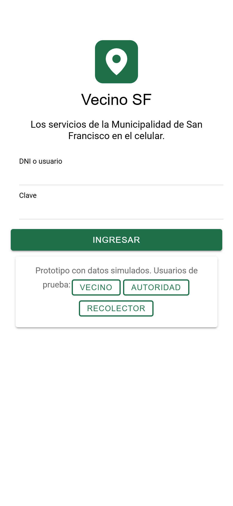<figcaption>Figura 2a. Ingreso</figcaption></figure>
<figure>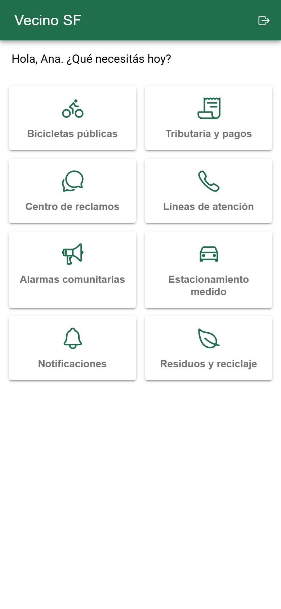<figcaption>Figura 2b. Inicio con los 8 servicios</figcaption></figure>
<figure>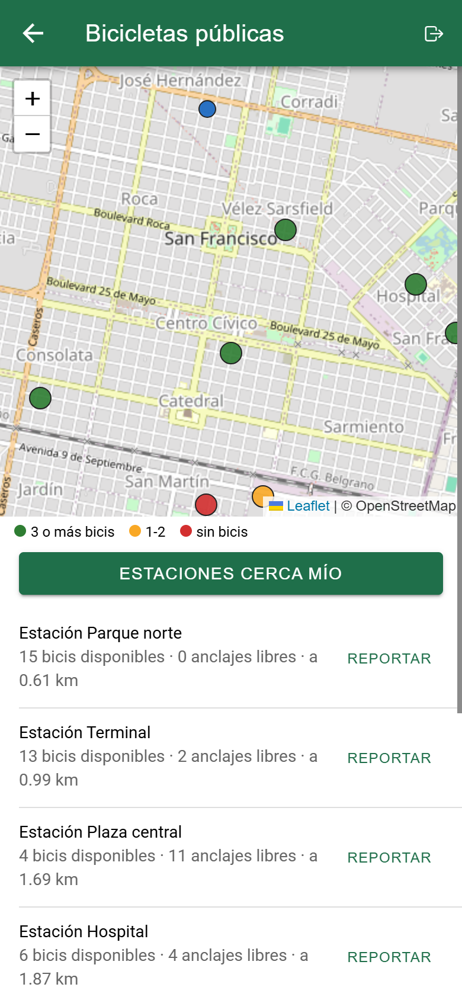<figcaption>Figura 3. Bicicletas cerca mío</figcaption></figure>
<figure>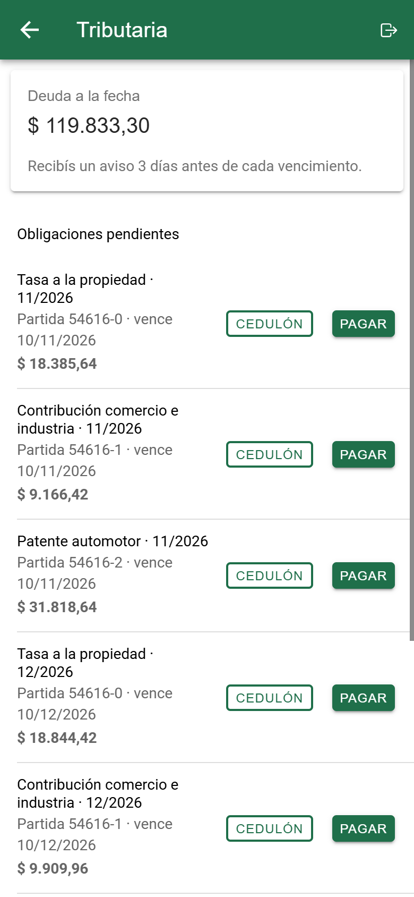<figcaption>Figura 4. Estado de cuenta</figcaption></figure>
<figure>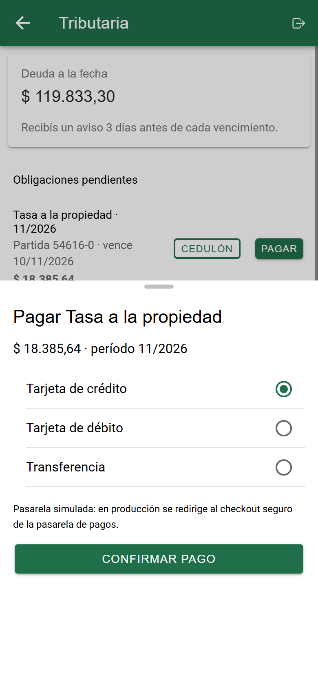<figcaption>Figura 5. Pago</figcaption></figure>
<figure>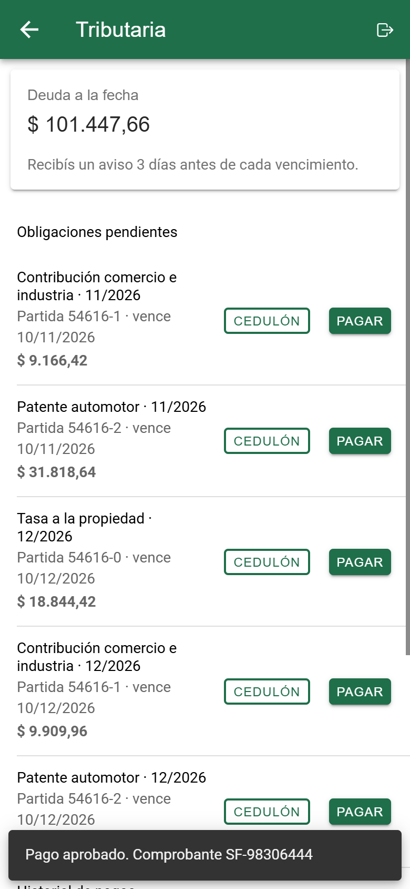<figcaption>Figura 6. Pago aprobado e historial</figcaption></figure>
<figure><figcaption>Figura 7. Cedulón emitido</figcaption></figure>
<figure>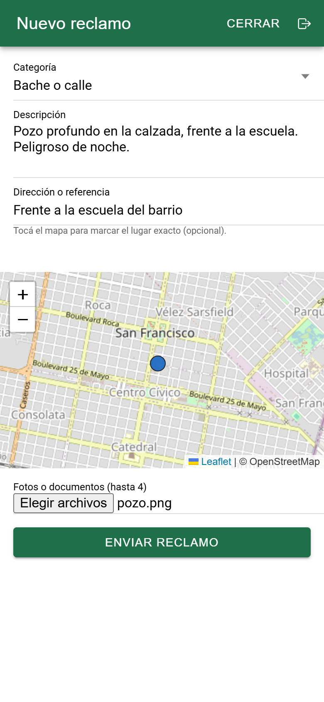<figcaption>Figura 8. Nuevo reclamo con foto</figcaption></figure>
<figure>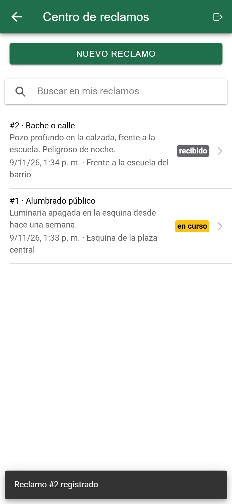<figcaption>Figura 9. Mis reclamos y buscador</figcaption></figure>
<figure>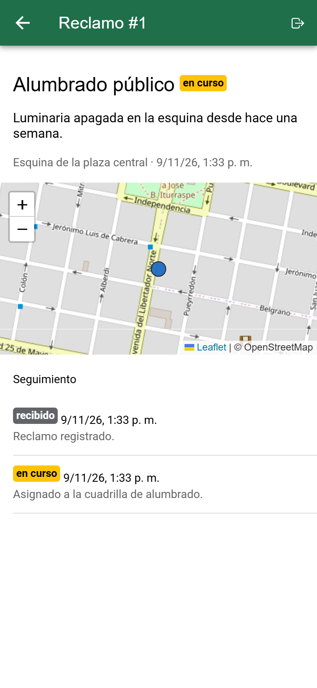<figcaption>Figura 10. Seguimiento del reclamo</figcaption></figure>
<figure>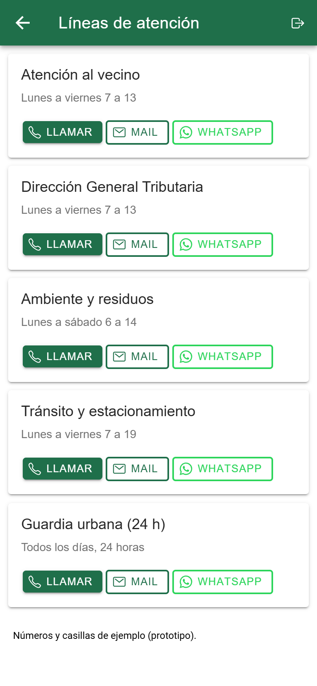<figcaption>Figura 11. Líneas de atención</figcaption></figure>
<figure>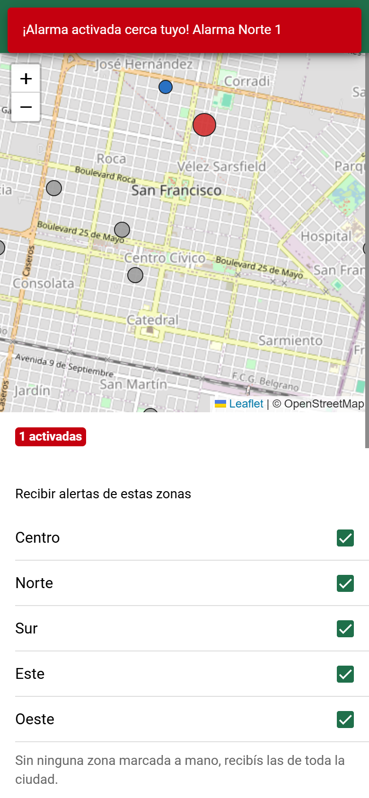<figcaption>Figura 12. Alarma activada y zonas</figcaption></figure>
<figure>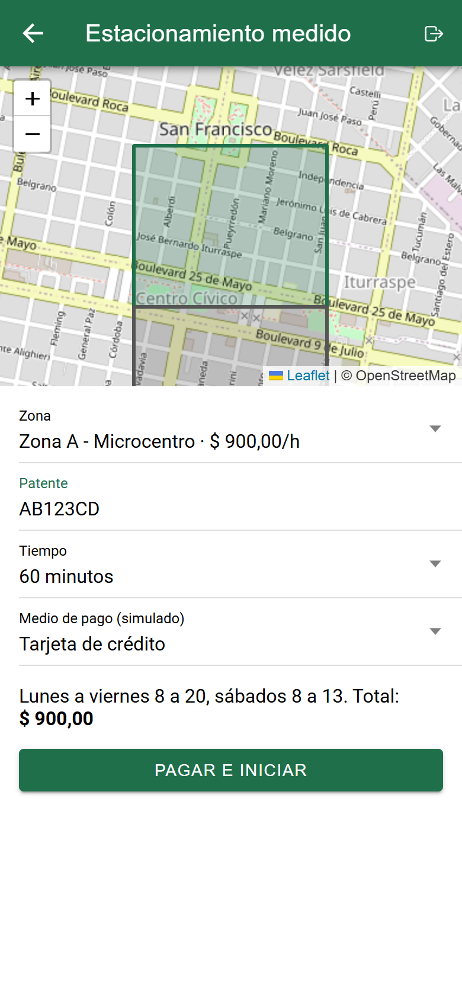<figcaption>Figura 13. Zonas y pago</figcaption></figure>
<figure>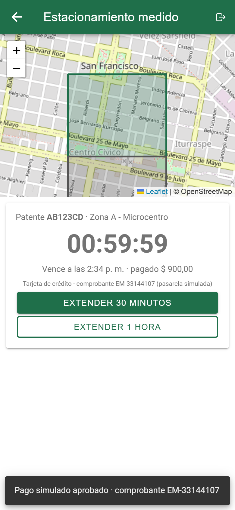<figcaption>Figura 14. Temporizador y extensión</figcaption></figure>
<figure>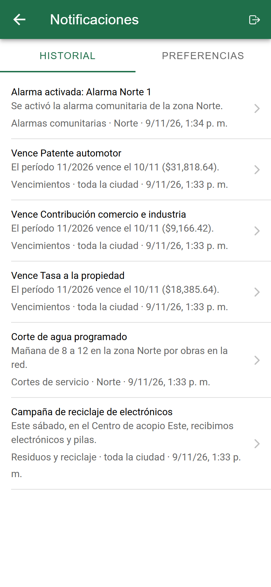<figcaption>Figura 15. Historial de avisos</figcaption></figure>
<figure>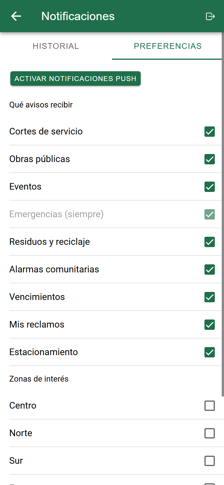<figcaption>Figura 16. Preferencias</figcaption></figure>

## 4. Requisitos no funcionales

| Requisito | Cómo se cumple y cómo se verificó |
|---|---|
| **Compatibilidad** | Componentes Ionic y diseño adaptable (todas las capturas son a 390 px de ancho; el panel de autoridad se adapta a escritorio). **Probado sólo en Edge** (motor Chromium), en un navegador de escritorio con el tamaño de un celular. Chrome, Firefox, Safari y un celular real **no se probaron**: se usan sólo funciones estándar, pero el push en iOS requiere instalar la app en la pantalla de inicio. |
| **Rendimiento (< 3 s)** | Se simuló un celular de gama media: CPU 4 veces más lenta y red 4G de 9 Mbps con 170 ms de latencia (parámetros en `frontend/pruebas/rendimiento.mjs`). Se mide hasta que la pantalla de ingreso responde: primera visita en **1,2 s** (199 KB transferidos), segunda en **0,39 s**, desde la caché del service worker. No incluye las pantallas con mapa, que además descargan Leaflet y las teselas. Registro en `docs/prueba-rendimiento.log`. |
| **Seguridad** | <ul><li>Claves guardadas con PBKDF2. Sesión con token firmado que vence a las 12 h.</li><li>Cada función del servidor exige su rol: un vecino no puede, por ejemplo, activar una alarma comunitaria (sólo la central, rol autoridad). Nadie ve cedulones ni reclamos ajenos.</li><li>El canal de tiempo real exige sesión y el servidor le manda cada aviso personal sólo a su dueño.</li><li>Los adjuntos se validan por su contenido (no por lo que declara el navegador), se guardan con una extensión fijada por el servidor y un nombre imposible de adivinar, y se sirven con `nosniff`.</li><li>Todo esto tiene pruebas automáticas (sección 5.1).</li></ul>**Falta para producción:** la clave que firma los tokens es un valor de ejemplo y hay que generarla al desplegar; el ingreso no limita los intentos; los usuarios de prueba están en la pantalla de ingreso. HTTPS está declarado en el Ingress de Kubernetes, pero la demostración corre en HTTP local. **Privacidad (Ley 25.326):** se guardan DNI, patente y la ubicación de reclamos y retiros. La ubicación del vecino para las alarmas no sale del celular. En producción hace falta informar la finalidad al registrarse, permitir la baja y definir cuánto tiempo se guardan esos datos. |
| **Usabilidad** | Inicio con un botón grande por servicio. Cada pantalla tiene un solo objetivo principal. Los errores del servidor se muestran en castellano. Botones de usuarios de prueba para la demostración. |
| **Escalabilidad** | En el servidor, los servicios se agrupan en tres módulos (`servicios.py`, `residuos.py` y `cuenta.py`, que tiene sesión y notificaciones). En la app, cada servicio es una pantalla aparte que se descarga sólo cuando se abre. Sumar un servicio no toca los demás. El servidor no guarda estado de sesión, así que escala sumando réplicas: con 120 usuarios simultáneos, 1 réplica atiende 131 pedidos/s con una mediana de 1 s, y 3 réplicas atienden 380 con 0,3 s, sin errores (`docs/prueba-carga.log`). Dos límites: los adjuntos necesitan un almacenamiento compartido (S3 o similar) cuando hay varias réplicas en Kubernetes, y un aviso a toda la ciudad se manda dentro del mismo pedido; con muchos vecinos habría que encolarlo. |

## 5. Pruebas y calidad del software

### 5.1 Pruebas realizadas

- **Pruebas automáticas de la API** (`backend/tests/test_api.py`, `pytest`): 21 en total,
  todas aprobadas. 18 son de este práctico (las otras 3 son del módulo de residuos). Cubren:
    - el login incorrecto y los permisos por rol, incluida la alarma que un vecino no puede
    activar;
    - el orden de las estaciones por distancia;
    - el pago, que no se puede pagar dos veces;
    - el cedulón ajeno, que no se puede ver;
    - el recordatorio de vencimiento;
    - el reclamo con foto y su seguimiento;
    - el rechazo de un ejecutable y de una página web que se hace pasar por imagen;
    - el adjunto guardado con extensión propia y servido con `nosniff`;
    - la alarma que avisa sólo a quien sigue esa zona;
    - el estacionamiento: patente inválida, uno activo por vez, comprobante por cada cobro,
    extensión y aviso único a los 10 minutos;
    - el canal de tiempo real: sin sesión no se abre, y un aviso personal no le llega a otro
    vecino;
    - las preferencias de avisos;
    - el push cifrado y firmado.
- **Tiempo real entre réplicas** (`deploy/prueba_tiempo_real.py`, registro en
  `docs/prueba-tiempo-real.log`). Con 3 réplicas, un vecino conectado a cada una recibe los 6
  cambios de alarma aunque cada cambio entre por una réplica distinta. El aviso personal de otro
  vecino no le llega a ninguna de sus conexiones.
- **Recorrido de punta a punta de la interfaz** (`frontend/pruebas/capturas.mjs`, Playwright
  sobre Edge). Ingresa como vecino, autoridad y recolector y completa cada flujo: pagar, cargar
  un reclamo con foto, estacionar, cambiar preferencias, etc. En cada paso espera el texto que
  tiene que aparecer y, si no aparece, la corrida se corta. No verifica los valores en detalle.
  Las capturas de este informe salen de esa corrida.
- **Prueba de rendimiento** (`frontend/pruebas/rendimiento.mjs`), sección 4.
- **Chequeo de tipos** de TypeScript en modo estricto (`npx tsc --noEmit`), sin errores.

### 5.2 Calidad del código

- **Una responsabilidad por archivo.** En el servidor: `servicios.py` para seis de los
  servicios, `cuenta.py` para la sesión y las notificaciones, `notificar.py` para los avisos y
  `eventos.py` para el tiempo real. En la app, una pantalla por servicio.
- **Un solo punto para avisar al vecino.** `notificar()` guarda el aviso en el historial, lo
  publica en tiempo real y manda el push respetando las preferencias. Ningún servicio
  reimplementa esa lógica.
- **Carga diferida.** Cada pantalla se descarga recién cuando se abre. El paquete inicial bajó
  de 1,41 MB a 861 KB (198 KB comprimido), y el vecino nunca descarga el lector de QR del
  recolector (340 KB).

## 6. Problemas encontrados y soluciones aplicadas

| Problema | Solución |
|---|---|
| Al ingresar, la pantalla quedaba **en blanco**. El enrutador de Ionic no acepta rutas dentro de condicionales ni fragmentos de React. | Cada rol tiene su lista de rutas y se generan como hijos directos del enrutador (`App.tsx`). |
| El paquete inicial pesaba **1,4 MB**. | Carga diferida por pantalla con `React.lazy`. |
| Con **varias réplicas** del servidor, un cambio en una réplica no les llegaba a los clientes conectados a otra. | Redis pub/sub: cada réplica publica los eventos y todas los reparten (`docs/prueba-tiempo-real.log`). |
| Una revisión del código antes de entregar encontró tres fallas de seguridad: **el canal de tiempo real era público** y repartía a todos los avisos personales (la app los filtraba, pero cualquiera podía leerlos); **cualquier vecino podía activar una alarma** comunitaria; y **un adjunto se validaba por el tipo que declara el navegador**, así que una página web marcada como imagen se guardaba y se servía como página. | El canal exige sesión y el servidor filtra por usuario; la alarma sólo la activa el rol autoridad; el tipo del adjunto se lee de sus primeros bytes. Las tres tienen prueba automática. |
| El **pago del estacionamiento** sólo calculaba el importe, pero la pantalla decía «pagado». | Mismo pago simulado que Tributaria, con medio de pago y comprobante por cada cobro. |
| En el navegador automatizado **el push no se puede suscribir**: rechaza el permiso de notificaciones. | El envío se verifica con una prueba del servidor: un servicio de push falso comprueba la firma y descifra el aviso. La suscripción en un celular real queda para la demostración. |

## 7. Funcionalidades adicionales

- **Instalable (PWA):** la app se instala desde el navegador como un ícono más, sin tienda.
- **Módulo de residuos:** registro de residuos, retiro de voluminosos y peligrosos, puntos
  verdes y horarios. Es el lado ciudadano del caso de gestión de residuos.

## 8. Repositorio y demostración

El código, las pruebas y las instrucciones están en el repositorio. Para la demostración en
clase alcanza con `docker compose up -d --build` en `deploy/` y abrir `http://localhost:8080`
en la computadora. Desde un celular de la misma red la app funciona, pero el navegador sólo
habilita el service worker y el push en HTTPS o en `localhost`. Para mostrar el push en el
celular hace falta publicarla con HTTPS, por ejemplo con un túnel.
